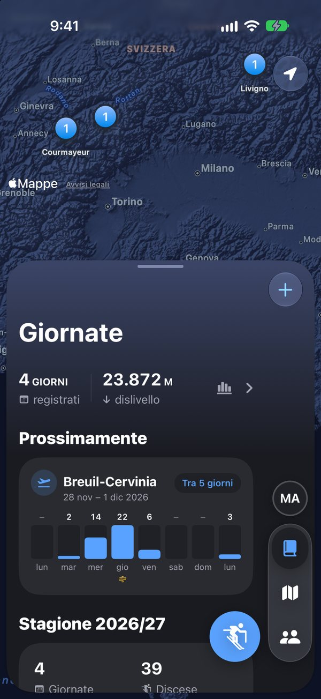
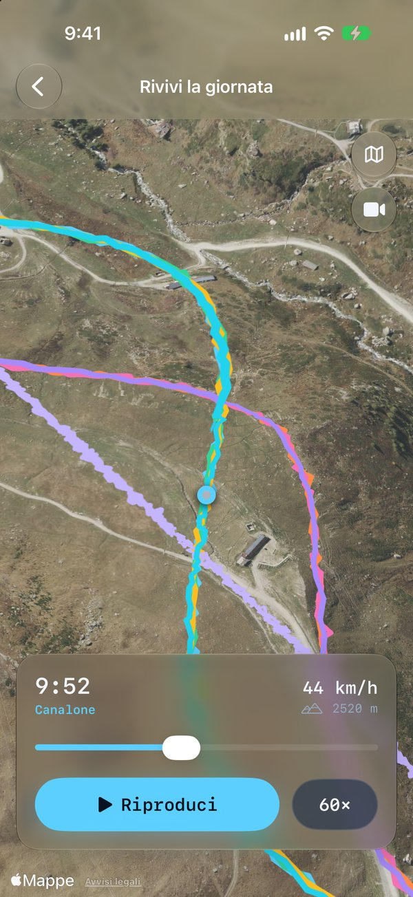
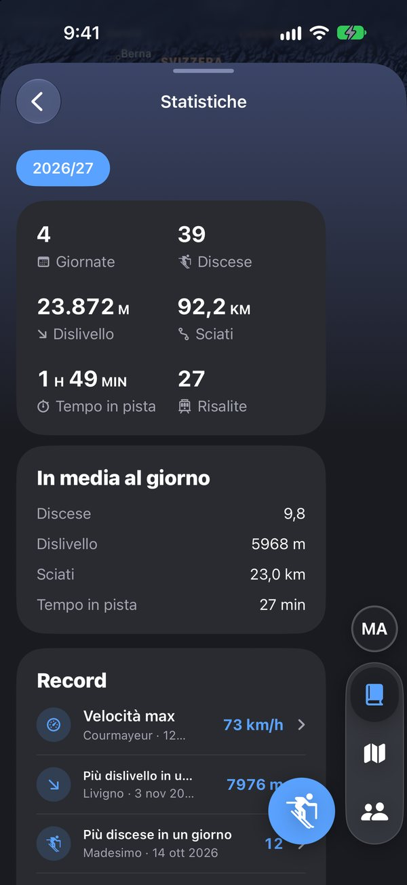
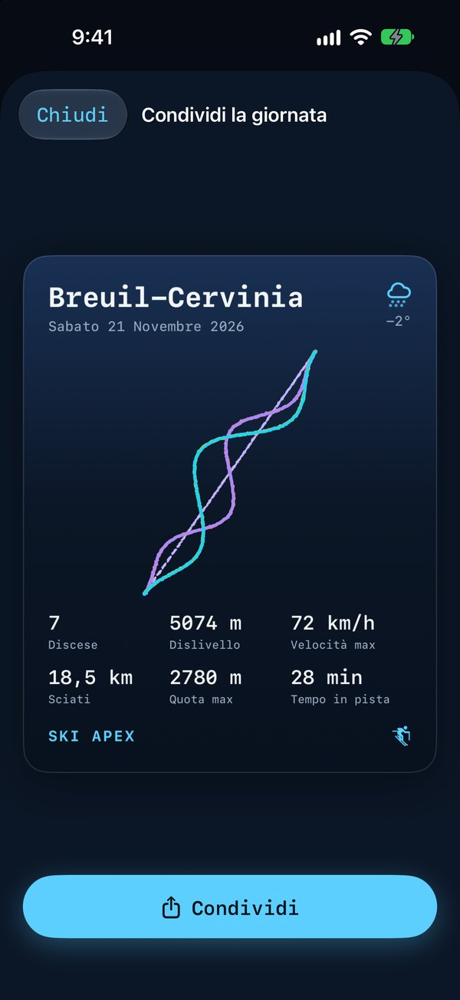

# Ski Apex

**🇮🇹 Il diario delle tue giornate sugli sci, per iPhone.** · **🇬🇧 The diary of your days on skis, for iPhone.**

---

## Italiano

Premi **Inizia** ai piedi della pista, metti l'iPhone in tasca e scia. Ski Apex registra il GPS anche a schermo spento, misura la quota con il barometro e riconosce da sola **discese** e **risalite**: niente da toccare durante la giornata.

- Velocità massima e media, dislivello, chilometri sciati, quota massima, tempo in pista e in risalita.
- Mappa della giornata con ogni discesa nel suo colore e le risalite tratteggiate (mappa o satellite).
- Grafico della quota durante la giornata, e per ogni discesa velocità, pendenza, partenza e arrivo.
- **Nomi delle piste e degli impianti** da OpenStreetMap, con il colore della difficoltà, e il **meteo** della giornata.
- **Cronologia** della giornata: discese, risalite e soste in ordine.
- **Rivivi la giornata**: il replay sulla mappa vista dall'alto, con ora, velocità e quota.
- **Velocità sulla mappa**: ogni discesa disegnata dal blu (lento) al rosso (veloce).
- **Statistiche**: totali, medie al giorno, record e grafici per stagione.
- **Immagine da condividere** con traccia e numeri; importazione ed esportazione **GPX**.
- Sci, snowboard, telemark o slittino; unità metriche o imperiali; italiano e inglese.
- Se l'app viene chiusa a metà giornata, la registrazione si ritrova al prossimo avvio.
- Le giornate restano sull'iPhone (visibili anche nell'app File). Nessun account, nessun server: per i nomi delle piste e il meteo viene chiesta solo la zona a OpenStreetMap e Open-Meteo, e si può spegnere.
- Niente neve? In Impostazioni si crea una giornata di prova.

  
  
  
  
  
  
  
  

### Installazione

- **TestFlight**: [link di invito](https://testflight.apple.com/join/Kszu8FAj).
- **Feather / AltStore / Sideloadly**: la `.ipa` non firmata delle [release](../../releases), oppure la sorgente Feather `https://raw.githubusercontent.com/TheBlackSide243/feather-repo/main/apps.json`.

Richiede iOS 17 o successivo. Velocità, distanze e quote sono stime del GPS e del barometro: non usarle per la sicurezza.

## English

Tap **Start** at the bottom of the slope, put your iPhone in your pocket and ski. Ski Apex records the GPS with the screen off, measures altitude with the barometer and recognizes **runs** and **lifts** on its own: nothing to touch during the day.

- Top and average speed, vertical, distance skied, top altitude, time on runs and on lifts.
- Map of the day with each run in its own color and dashed lifts (map or satellite).
- Altitude through the day, and for each run its speed, slope, start and finish.
- **Piste and lift names** from OpenStreetMap, with the color of the difficulty, and the **weather** of the day.
- **Timeline** of the day: runs, lifts and breaks in order.
- **Replay the day** on the map seen from above, with time, speed and altitude.
- **Speed on the map**: every run drawn from blue (slow) to red (fast).
- **Stats**: totals, averages per day, records and charts by season.
- **Picture to share** with the track and the numbers; **GPX** import and export.
- Ski, snowboard, telemark or sled; metric or imperial units; Italian and English.
- If the app is closed during the day, the recording comes back at the next launch.
- Your days stay on the iPhone (also visible in the Files app). No account, no server: for piste names and weather only the area is asked to OpenStreetMap and Open-Meteo, and it can be turned off.
- No snow? Make a sample day in Settings.

### Install

- **TestFlight**: [invite link](https://testflight.apple.com/join/Kszu8FAj).
- **Feather / AltStore / Sideloadly**: the unsigned `.ipa` from the [releases](../../releases), or the Feather source `https://raw.githubusercontent.com/TheBlackSide243/feather-repo/main/apps.json`.

Requires iOS 17 or later. Speeds, distances and altitudes are estimates from GPS and the barometer: do not rely on them for safety.

---

### Build

SwiftUI, no dependencies. `xcodegen generate`, then open `SkiApex.xcodeproj`. The `.ipa` is built by GitHub Actions (`.github/workflows/ipa.yml`); the tests run with `unittests.yml`, the pictures above come from `screenshots.yml`.

© 2026 TheBlackSide243. All rights reserved: see [LICENSE](LICENSE).
