# Ski Apex

**🇮🇹 Il diario delle tue giornate sugli sci, per iPhone.** · **🇬🇧 The diary of your days on skis, for iPhone.**

---

## Italiano

Premi **Inizia** ai piedi della pista, metti l'iPhone in tasca e scia. Ski Apex registra il GPS anche a schermo spento, misura la quota con il barometro e riconosce da sola **discese** e **risalite**: niente da toccare durante la giornata.

- Velocità massima e media, dislivello, chilometri sciati, quota massima, tempo in pista e in risalita.
- **La mappa dietro a tutto**: le schermate stanno su un pannello che tiri su e giù sopra la mappa; sul suo bordo destro la tua foto, Giornate, Guida, Amici e il pulsante tondo che registra.
- **Mappa invernale**: neve con le ombre del rilievo e una curva di livello ogni 50 metri, disegnata dall'app a partire da quote libere; da lontano, le montagne di notte. Sopra restano i nomi della mappa di Apple.
- Mappa della giornata con le discese, e le risalite tratteggiate.
- Grafico della quota durante la giornata, e per ogni discesa velocità, pendenza, partenza e arrivo.
- **Nomi delle piste e degli impianti** da OpenStreetMap, con il colore della difficoltà, e il **meteo** della giornata.
- **Cronologia** della giornata: discese, risalite e soste in ordine.
- **Rivivi la giornata**: il replay sulla mappa vista dall'alto, con ora, velocità e quota.
- **Velocità sulla mappa**: ogni discesa disegnata dal blu (lento) al rosso (veloce).
- **Statistiche**: totali, medie al giorno, record e grafici per stagione.
- **Le tue piste**: per ogni pista quante volte l'hai fatta, il tuo tempo migliore e la velocità massima, con i tempi uno per uno. Con la **sfida** accesa, in ogni pista c'è la classifica dei tempi con gli amici.
- **Immagine da condividere**, in formato post o storia: le discese nel colore della pista, il profilo della giornata e i numeri; importazione ed esportazione **GPX**.
- **Amici**: classifiche della stagione con gli amici che inviti (giorni sulla neve, dislivello, chilometri, discese, velocità), con la foto del profilo. Account con nome e password, con Apple o con Google.
- **Amici in diretta**: mentre registri vedi sulla mappa gli amici che stanno sciando, e loro vedono te, se lo accendi. Un avviso ti dice quando uno è a meno di 300 metri o scia nella tua zona; con il Bluetooth, se lo accendi, anche dove non c'è campo.
- **Punto d'incontro**: sulla mappa di una stazione tocca un rifugio, una pista o un impianto e scegli "Troviamoci qui"; gli amici lo vedono sulla mappa, con il percorso sulle piste per arrivarci, e rispondono se ci sono o no: chi l'ha proposto vede chi ha accettato e chi ha rifiutato.
- **Guida delle stazioni**: cerca una stazione, guarda quelle vicine e segui le tue, con la neve prevista per 8 giorni. Ogni stazione ha la sua pagina: piste, impianti e quote, la neve di oggi ora per ora e quella dell'ultima settimana.
- **Com'era la neve**: a fine giornata l'app te lo chiede (farinosa, battuta, ghiacciata...). Se vuoi, lo dice a chi scia lì: nella pagina della stazione si vede com'è la neve secondo chi c'è stato, la giornata media e quali amici ci sono passati.
- **Mappe scaricate**: piste, impianti e rifugi di una stazione sull'iPhone, per quando non c'è campo; e mentre scii vedi il nome della pista su cui sei.
- **Riepilogo della stagione**: i numeri della stagione in un'immagine da condividere.
- **Mappa delle piste e percorsi**: piste nel colore della difficoltà, impianti e rifugi di una stazione; tocca da dove parti e dove vuoi arrivare e trova la strada, anche solo sulle piste blu o rosse.
- **Diario** con la mappa dei posti dove hai sciato, i **viaggi in programma** e le **giornate scritte a mano**.
- **Mappa di calore**: tutte le tue discese in un posto, una sull'altra.
- **Schermata di blocco e Dynamic Island**: la giornata in corso sempre sott'occhio (Live Activity).
- **Siri e Comandi Rapidi**: inizia, metti in pausa e finisci la giornata a voce.
- **Apple Watch**: registra la giornata da solo con il suo GPS, con battito, velocità, discese e dislivello al polso, e la manda all'iPhone quando finisci; oppure fa da telecomando quando registra l'iPhone. Dall'iPhone puoi anche passare la giornata al Watch ("Continua sul Watch") e mettere via il telefono: a fine giornata le due parti diventano una giornata sola (nella versione TestFlight).
- **Widget**: la neve in arrivo in una località a scelta, e un tasto per registrare, sulla schermata Home e sulla schermata di blocco; sul Watch una complicazione che apre l'app dal quadrante.
- **Temi e icone**: sei aspetti per l'app (notte, aurora, alba, bosco, carbone e uno chiaro, neve) e l'icona negli stessi colori.
- **Foto della giornata** dalla tua libreria, trovate dall'orario.
- **Apple Salute**: la giornata come allenamento con il percorso, e il battito se porti un Apple Watch (nella versione TestFlight).
- **Copia di sicurezza** di tutte le giornate in un file zip, e ripristino. La **copia su iCloud** delle giornate c'è solo dove l'app è firmata con iCloud: nella versione TestFlight va ancora attivata.
- Sci, snowboard, telemark o slittino, scelti prima di iniziare; unità metriche o imperiali; italiano e inglese.
- Se l'app viene chiusa a metà giornata, la registrazione si ritrova al prossimo avvio.
- Le giornate restano sull'iPhone (visibili anche nell'app File). Per i nomi delle piste e il meteo viene chiesta solo la zona a OpenStreetMap e Open-Meteo, e si può spegnere. L'account serve solo per gli Amici, e lì arrivano il nome e i totali della stagione: mai le tracce o i posti delle giornate. La posizione in diretta parte solo se la accendi, solo mentre registri, e il server non la salva. Com'era la neve lo dici tu a fine giornata, se vuoi: parte la zona della stazione al chilometro con i numeri della giornata, senza nomi. Per la mappa invernale vengono chiesti a un archivio pubblico (AWS Open Data) i riquadri della zona che guardi, come quote: si spegne con lo stesso interruttore.
- Niente neve? In Impostazioni si crea una giornata di prova.

  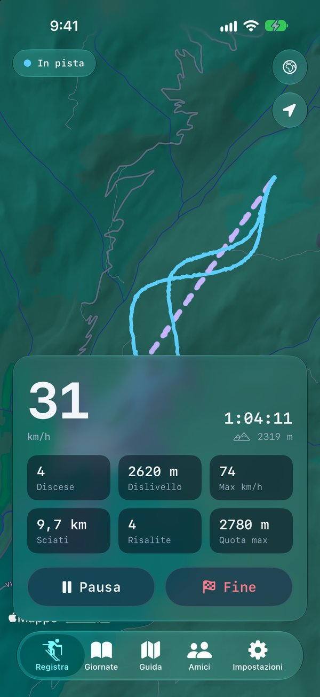
  
  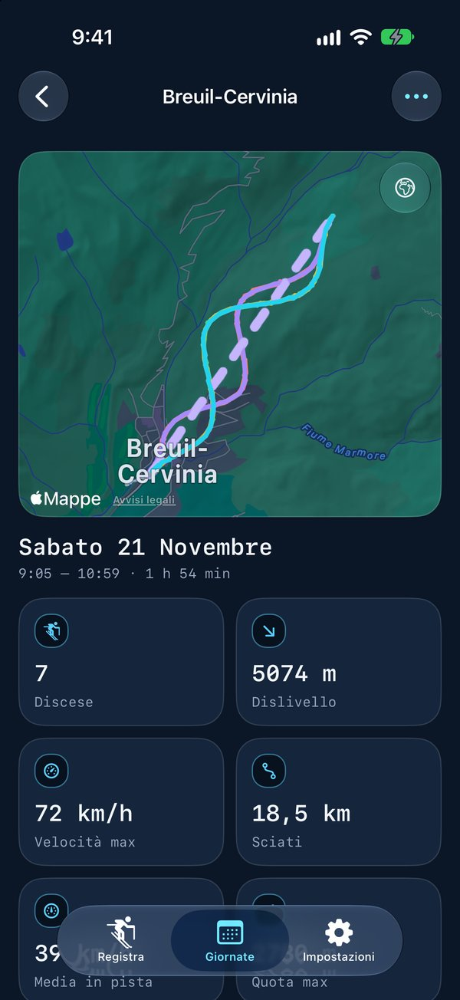
  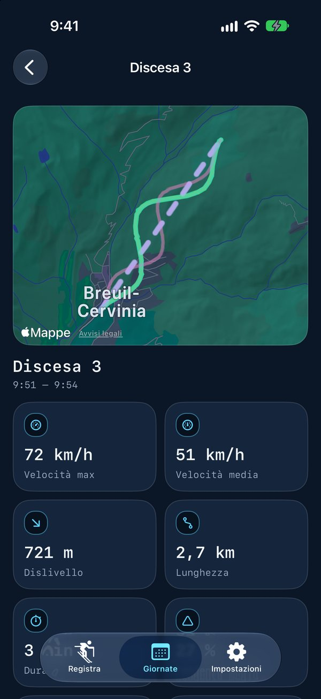
  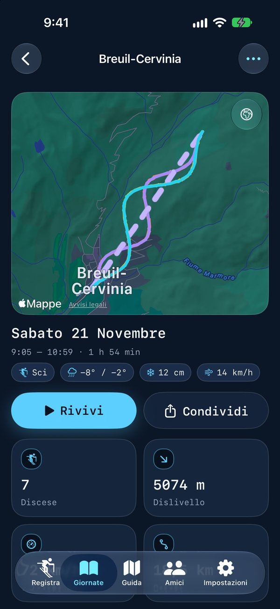
  
  
  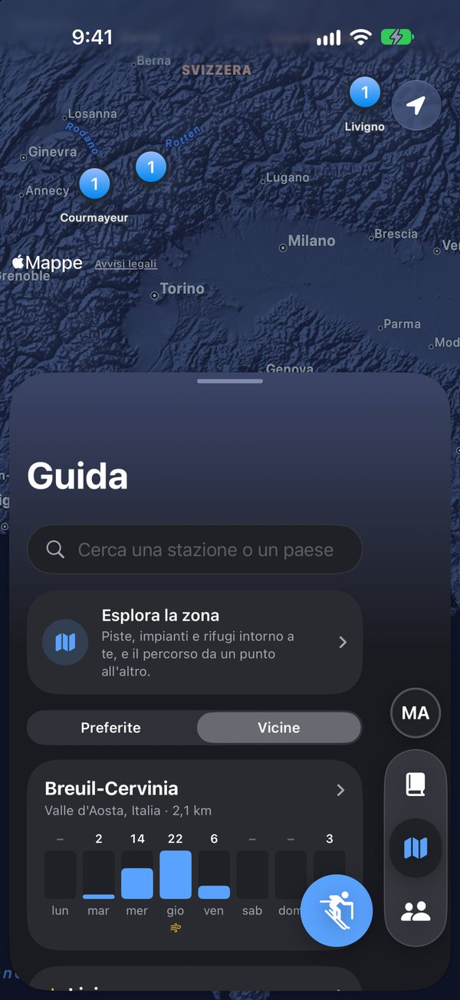
  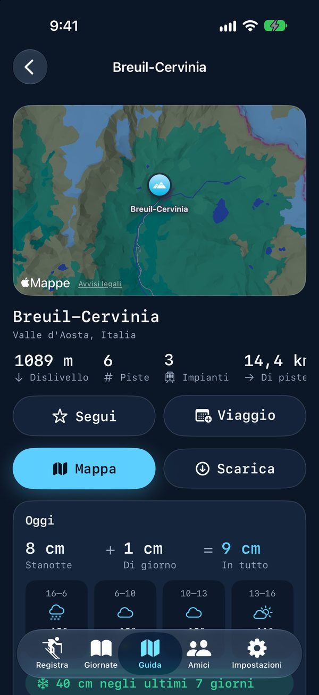
  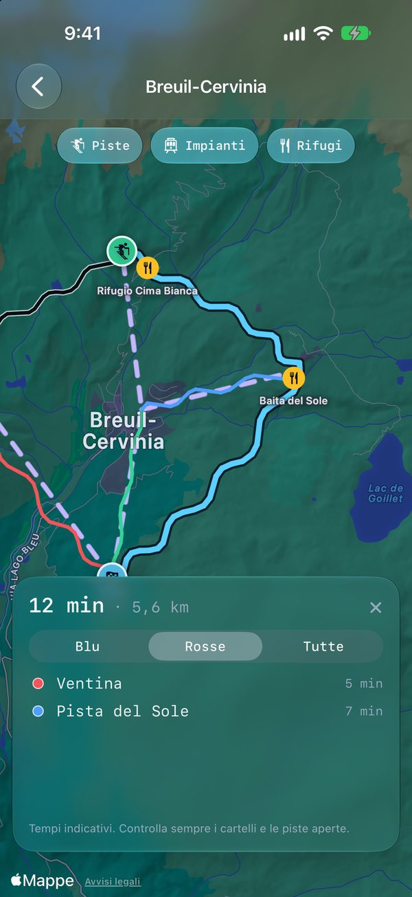
  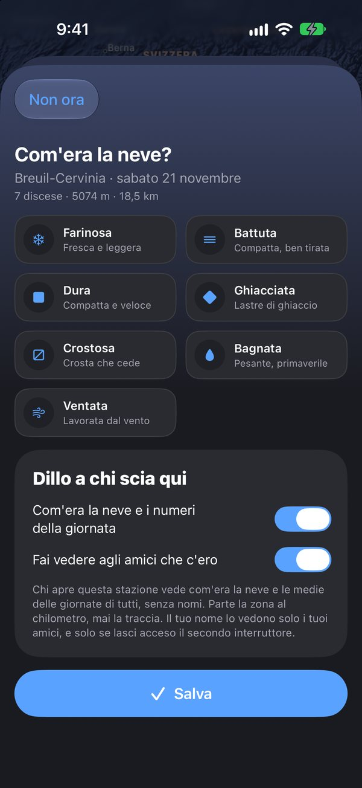
  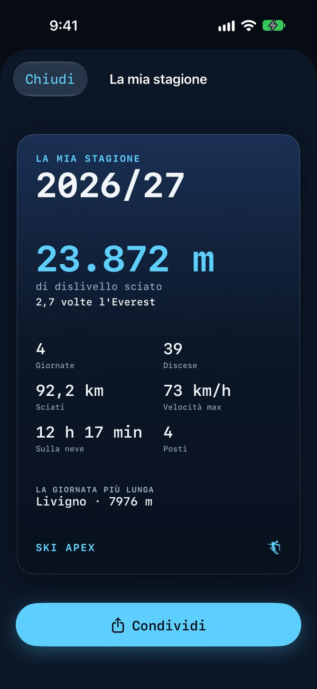
  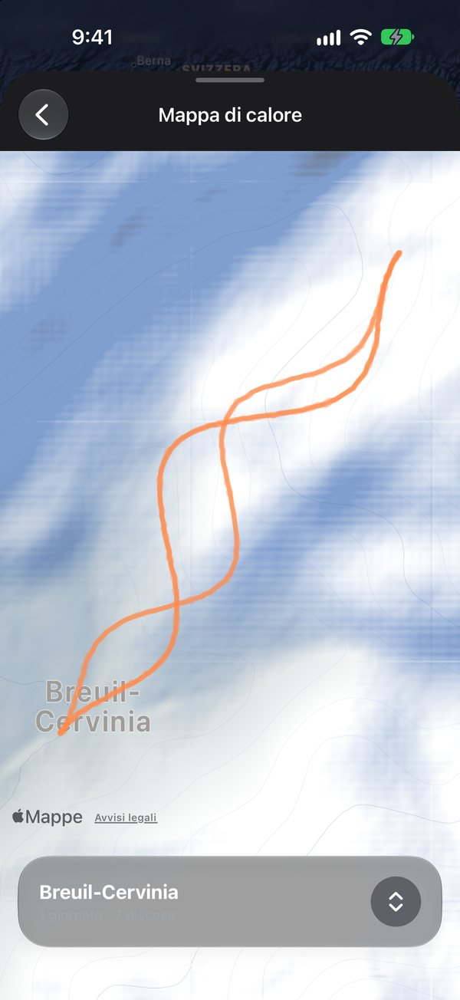
  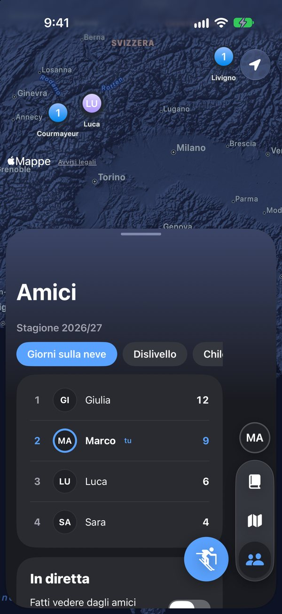
  
  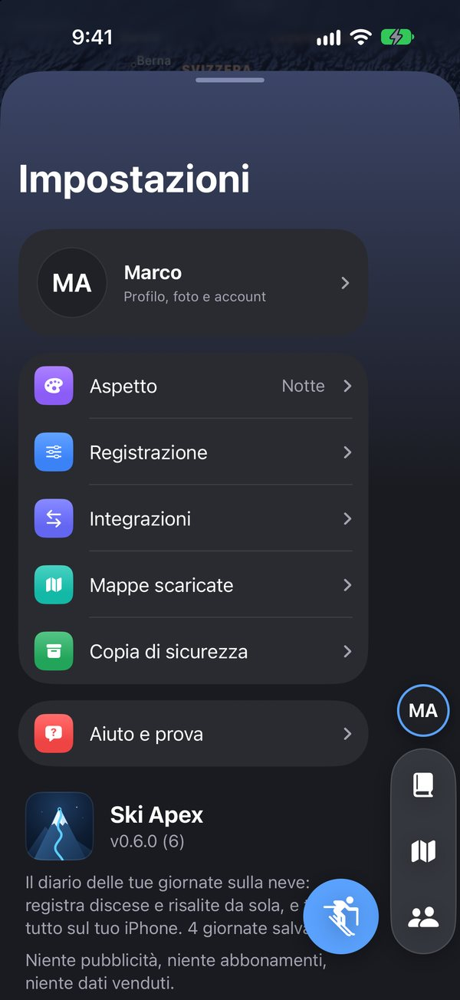
  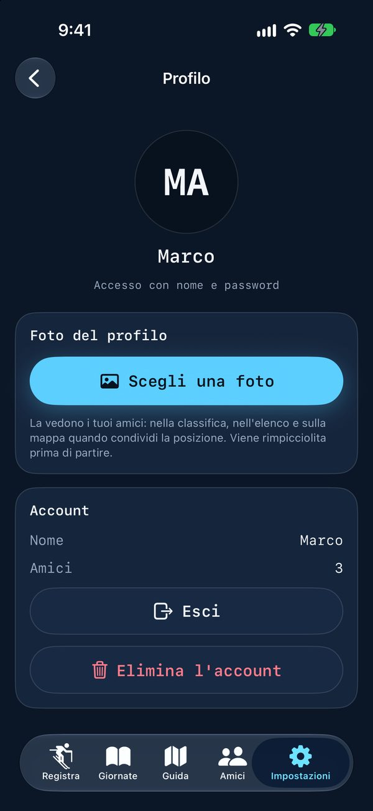
  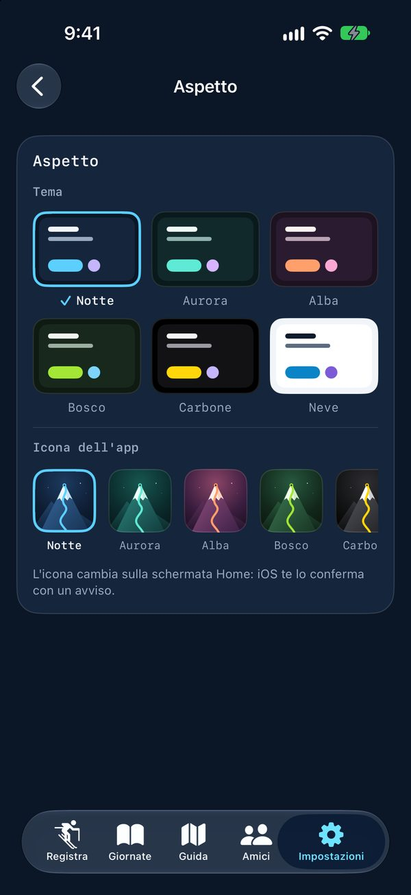
  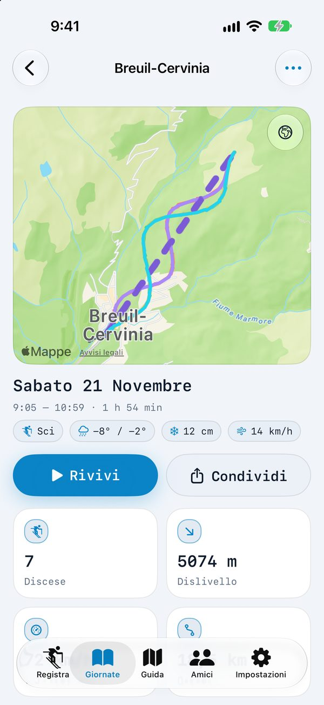

### Installazione

- **TestFlight**: [link di invito](https://testflight.apple.com/join/Kszu8FAj).
- **Feather / AltStore / Sideloadly**: la `.ipa` non firmata delle [release](../../releases), oppure la sorgente Feather `https://raw.githubusercontent.com/TheBlackSide243/feather-repo/main/apps.json`.

Richiede iOS 17 o successivo. Velocità, distanze e quote sono stime del GPS e del barometro: non usarle per la sicurezza.

## English

Tap **Start** at the bottom of the slope, put your iPhone in your pocket and ski. Ski Apex records the GPS with the screen off, measures altitude with the barometer and recognizes **runs** and **lifts** on its own: nothing to touch during the day.

- Top and average speed, vertical, distance skied, top altitude, time on runs and on lifts.
- **The map behind everything**: the screens are on a sheet you pull up and down over the map; on its right edge your picture, Days, Guide, Friends and the round button that records.
- **Winter map**: snow with the shade of the relief and a contour line every 50 meters, drawn by the app from open heights; from far away, the mountains at night. The names of Apple's map stay over it.
- Map of the day with its runs, and dashed lifts.
- Altitude through the day, and for each run its speed, slope, start and finish.
- **Piste and lift names** from OpenStreetMap, with the color of the difficulty, and the **weather** of the day.
- **Timeline** of the day: runs, lifts and breaks in order.
- **Replay the day** on the map seen from above, with time, speed and altitude.
- **Speed on the map**: every run drawn from blue (slow) to red (fast).
- **Stats**: totals, averages per day, records and charts by season.
- **Your pistes**: for each piste how many times you skied it, your best time and your top speed, with the times one by one. With the **challenge** on, each piste has the ranking of the times with your friends.
- **Picture to share**, as a post or as a story: the runs in the color of their piste, the profile of the day and the numbers; **GPX** import and export.
- **Friends**: season leaderboards with the friends you invite (days on the snow, vertical, distance, runs, speed), with profile pictures. An account with a name and a password, with Apple or with Google.
- **Friends live**: while you record you see on the map the friends who are skiing, and they see you, if you turn it on. A notice tells you when one is within 300 meters or skiing in your area. With Bluetooth, if you turn it on, also where there is no signal.
- **Meeting point**: on the map of a ski area touch a hut, a piste or a lift and choose "Let's meet here"; your friends see it on the map, with the way along the pistes to get there, and answer whether they are coming: who set it sees who accepted and who refused.
- **Guide to ski areas**: search one, see the ones nearby and follow yours, with the snow expected for 8 days. Each ski area has its page: pistes, lifts and altitudes, today's snow hour by hour and the snow of the last week.
- **How the snow was**: at the end of a day the app asks (powder, groomed, icy...). If you like, it tells who skis there: the page of the ski area shows how the snow is according to who has been, the average day and which friends passed by.
- **Downloaded maps**: the pistes, lifts and huts of a ski area on the iPhone, for when there is no signal; and while you ski you see the name of the piste you are on.
- **Season recap**: the numbers of the season in a picture to share.
- **Piste map and routes**: the pistes in the color of their difficulty, the lifts and the huts of a ski area; touch where you leave from and where you want to get and find the way, on blue or red pistes only if you like.
- **Diary** with the map of the places you skied, your **planned trips** and **days written by hand**.
- **Heat map**: all your runs in one place, one over the other.
- **Lock screen and Dynamic Island**: the day under way always in sight (Live Activity).
- **Siri and Shortcuts**: start, pause and finish the day by voice.
- **Apple Watch**: records the day by itself with its GPS, with heart rate, speed, runs and vertical on your wrist, and sends it to the iPhone when you finish; or works as a remote when the iPhone records. From the iPhone you can also pass the day to the Watch ("Go on on the Watch") and put the phone away: at the end of the day the two parts become one day (in the TestFlight build).
- **Widgets**: the snow to come at a place of your choice, and a button to record, on the Home Screen and the Lock Screen; on the Watch a complication that opens the app from the watch face.
- **Looks and icons**: six looks for the app (night, aurora, sunrise, forest, carbon and a light one, snow) and the icon in the same colors.
- **Photos of the day** from your library, found by their time.
- **Apple Health**: the day as a workout with its route, and the heart rate if you wear an Apple Watch (in the TestFlight build).
- **Backup** of all your days in one zip file, and restore. The **copy in iCloud** of the days is only where the app is signed with iCloud: in the TestFlight build it is still to be turned on.
- Skiing, snowboarding, telemark or sled, chosen before you start; metric or imperial units; Italian and English.
- If the app is closed during the day, the recording comes back at the next launch.
- Your days stay on the iPhone (also visible in the Files app). For piste names and weather only the area is asked to OpenStreetMap and Open-Meteo, and it can be turned off. An account is needed only for Friends, and your name and the totals of the season go there: never the tracks or the places of your days. Your live position is sent only if you turn it on, only while you record, and the server does not store it. How the snow was is told by you at the end of a day, if you like: the area of the ski area to the kilometer with the numbers of the day, with no names. For the winter map the squares of the area you look at are asked for, as heights, to a public archive (AWS Open Data): the same switch turns it off.
- No snow? Make a sample day in Settings.

### Install

- **TestFlight**: [invite link](https://testflight.apple.com/join/Kszu8FAj).
- **Feather / AltStore / Sideloadly**: the unsigned `.ipa` from the [releases](../../releases), or the Feather source `https://raw.githubusercontent.com/TheBlackSide243/feather-repo/main/apps.json`.

Requires iOS 17 or later. Speeds, distances and altitudes are estimates from GPS and the barometer: do not rely on them for safety.

---

### Build

SwiftUI, no dependencies. `xcodegen generate`, then open `SkiApex.xcodeproj`. The friends' server (a Cloudflare Worker) is in [`server`](server). The `.ipa` is built by GitHub Actions (`.github/workflows/ipa.yml`); the tests run with `unittests.yml`, the pictures above come from `screenshots.yml`.

© 2026 TheBlackSide243. All rights reserved: see [LICENSE](LICENSE).
